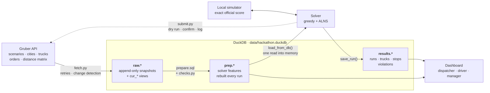

# Logi-Wise · truck planning for Gruber Logistics

[](https://github.com/tercasaskova311/logiwise/actions/workflows/ci.yml)


A pickup-and-delivery truck planner built at the Gruber Logistics hackathon 2026
(NOI Techpark, team 5). It pulls orders, trucks and distances from Gruber's API into a layered
DuckDB pipeline, plans routes with a search that is scored by an exact local copy of the official
simulator, and shows the result to dispatchers, drivers and managers on a map.

**Result: 932.26 / 1000 on the competitive scenario (200 orders, 25 trucks), zero rule violations.
Every API submission returned exactly the score our local simulator predicted.**

## Highlights

- **Layered data pipeline.** `raw.*` keeps every API response as an append-only snapshot,
  `prep.*` is rebuilt from SQL on every run, `results.*` stores every scored plan. Re-running is
  idempotent: a new snapshot is written only when the API data actually changed.
- **Data-quality gates.** Grain checks on every `prep` table (catches joins that duplicate rows),
  about 20 domain checks (symmetric distance matrix, contiguous positions, every order carriable by some truck, time windows that can be met). A failing check stops the pipeline.
- **Exact simulator.** A local Validate / Simulate / Score that matches the official API on
  156 saved responses to the last digit, so the solver never spends the 3 scoring calls blindly.
- **Tested in CI.** Unit tests, an end-to-end pipeline run against a fake API, the data-quality
  checks on the committed database and the simulator parity check run on every push.
- **One command to run.** `make ci`, `make dashboard` or `docker run`, no API key needed: the
  committed DuckDB file holds all scenarios and scored plans.

## Architecture



| Layer | Tables | Written by | Rule |
|---|---|---|---|
| `raw` | `snapshots`, `cities`, `trucks`, `orders`, `distances`, views `cur_*` | `ingestion/fetch.py` | Never updated or deleted. A SHA-256 fingerprint of the API data decides whether a new `snapshot_id` is needed. |
| `prep` | `city_index`, `city_distances`, `truck_features`, `order_base`, `order_features`, `order_truck_options`, `scenario_summary` | `ingestion/prepare.sql` | Dropped and rebuilt in one transaction; every table has a declared grain that `checks.py` enforces. |
| `results` | `runs`, `run_trucks`, `run_stops`, `run_violations` | `ingestion/load.py` `save_run()` | Append only. Every plan the team evaluated, with score, metrics and per-stop schedule. |

Why it is built this way:

- **Append-only raw data** keeps runs reproducible. A server restart regenerates all scenarios,
  so every plan in `results.*` keeps a pointer to the exact snapshot it was built on.
- **Features in SQL, solving in Python.** The heavy joins (which truck can carry which order,
  earliest possible arrival, slack in each time window) live in `prepare.sql`. The solver reads
  them once into plain lists, because a DuckDB query is about 14,000 times slower than a list
  lookup inside a search loop.
- **Every key includes `scenario_id`.** City, truck and order ids repeat across scenarios;
  the grain checks catch any join that forgets it.

Full description of every table and column: [`ingestion/README.md`](ingestion/README.md).

## Quick start

```bash
pip install -r requirements.txt
make ci           # tests, pipeline against a fake API, data-quality checks, simulator parity
make dashboard    # http://localhost:8501
make solve        # solver on scenario_big for 60 s
```

Or with Docker, no local Python needed:

```bash
docker build -t logiwise .
docker run --rm -p 8501:8501 logiwise
```

`make help` lists every target. None of them call the scoring API.

## Dashboard and sign-in

The Streamlit dashboard opens on a sign-in screen. The account decides what you see:

| Role | Sees | Can do |
|---|---|---|
| **Dispatcher** | every route on the map, fleet numbers, unserved orders with the reason each one was left out, and a **Data** tab: row counts per pipeline layer, live data-quality check status, which snapshot the plan was built on, and the history of solver runs | open any truck, preview the driver view |
| **Driver** | only the truck on their account | step through the stops, mark each one done |

Demo accounts (shown on the sign-in screen): `dispatcher` / `dispatch-demo` and `driver` / `driver-demo`.
Real accounts go in `.streamlit/secrets.toml` (template: [`.streamlit/secrets.example.toml`](.streamlit/secrets.example.toml));
once that file has users, the demo accounts are switched off. Passwords are stored as salted
PBKDF2 hashes (`python dashboard/auth.py '<password>'` makes one), and five wrong passwords in a
row pause sign-in for 30 seconds. This is demo-grade access control, not user management.

## Deploy the demo (Streamlit Community Cloud, free)

1. Sign in at [share.streamlit.io](https://share.streamlit.io) with GitHub and click **Create app**.
2. Repository `tercasaskova311/logiwise`, branch `main`, main file `dashboard/app.py`.
   Under **Advanced settings** pick Python 3.12.
3. Deploy. The committed `data/hackathon.duckdb` is all the app needs; no API key.
4. Optional: paste real accounts into the app's **Secrets** (format in
   `.streamlit/secrets.example.toml`). Without them the demo accounts stay on.

The same image also runs anywhere Docker does (`docker run -p 8501:8501 logiwise`).

## Team

Team 5 at the Gruber Logistics hackathon 2026. Data architecture and the DuckDB pipeline
(`ingestion/`): [tercasaskova311](https://github.com/tercasaskova311). Solver, simulator and
dashboard were built together by the team; see the commit history for details.

Rules, domain details and team workflow: [CLAUDE.md](CLAUDE.md) and [docs/semantics.md](docs/semantics.md).

## Structure

| Folder | What it is |
|---|---|
| `simulator/` | API client and exact local Validate / Simulate / Score (the reference for every rule) |
| `ingestion/` | DuckDB pipeline: `raw.*` API data → `prep.*` solver features → `results.*` scored plans |
| `solver/` | Greedy insertion + ALNS, scored with the exact official score; `explain.py` says why an order is unserved |
| `dashboard/` | Streamlit map: routes on real roads, load on board, unserved orders |
| `tools/` | Parity checks, portfolio runs, plan polishing, benchmarks |
| `tests/` | pytest: simulator parity + solver evaluator |
| `.github/workflows/` | CI: tests, pipeline end-to-end, data checks, parity |
| `docs/` | Challenge PDF, API docs, verified rules |
| `data/` | `hackathon.duckdb` (all scored plans and API scores), scenario snapshots, road shapes, parity cases |

## How the solver works

### The problem

We get a list of orders (pick up here, deliver there), a fleet of trucks, and the distances
between cities. We decide which truck carries which order and in what sequence it makes its stops.
A plan scores up to 1000 points:

- half of the score is how much order value gets delivered;
- the other half is low cost, low CO2 and few empty kilometres.

Trucks differ in size and type (standard, refrigerated, hazardous goods), drivers must take breaks,
and some orders have a time window: more than 60 minutes late and the order does not count.

There are far too many possible plans to try them all, so we improve a plan step by step.

### The base: destroy and repair (ALNS)

1. **Build a first plan.** Add the orders one at a time, each at the place where it raises the
   score the most. Orders with a time window go first.
2. **Destroy.** Take a few orders out of the plan (5 % to 30 % of them). Several rules choose
   which: random ones, the ones that add little, ones close to each other, a whole truck, or the
   ones next to a long empty drive.
3. **Repair.** Put them back, each at its best place.
4. **Keep or discard.** A better plan is kept. A slightly worse one is sometimes kept too,
   often at the start and rarely at the end, so the search does not get stuck too early.
5. **Learn.** Rules that found improvements are picked more often.
6. Repeat steps 2 to 5 until the time is up, then return the best plan seen.

This method is called Adaptive Large Neighbourhood Search (ALNS). One thing is special in our
version: every decision is judged by the **real score**. We wrote an exact copy of the official
simulator (it matches the API on 156 test plans, to the last digit), so the solver never works
with an estimate.

### What we added on top

Each add-on was kept only if it helped across all our test data (the 4 official scenarios plus
3 that we generated ourselves) and several random starts. The numbers are for the largest
scenario, `competitive` (200 orders, 25 trucks), averaged over runs of 60 seconds.

| Step | What it does | Score |
|---|---|---|
| First plan only | step 1 above, no improvement loop | 908 |
| Base ALNS | the destroy and repair loop | 916 |
| + Speed | the same search with less repeated work, so 1.5 to 2 times more steps in the same time | 920 |
| + Making room | for an order that is left out: take one or two orders off a truck that could reach it in time, put the left-out order in, and find new places for the ones taken off | 925 |
| + Time windows first | plan only the time-window orders first, as their own small puzzle, then fit all other orders around them and do not move them again | 928 |
| + Several runs | run the normal version and the time-windows-first version side by side with different random starts, for 5 minutes each, and keep the best plan | 932.22 |
| + Polishing | take the finished plan and try thousands of tiny changes (move 1 to 3 orders to a better place), keeping only the ones that raise the score; this removes some empty kilometres | **932.26** |

"Time windows first" helps on some data and hurts on other data, so it is not the default.
Running both versions and keeping the better plan gets the gain without the risk.

### What we tried that did not help

- **Reducing empty first drives.** The empty kilometres that remain are forced by truck size and
  time windows.
- **Removing whole stretches of neighbouring routes at once** (the SISR method). Same score.
- **Changing how much is destroyed, and restarting when stuck.** Smaller steps after a success, larger
  ones when nothing improves, and a restart from the best plan after a long quiet period. Same score.
- **Mixing routes from different plans.** The orders that only some plans deliver all need the same
  truck at the same hour, so the best mix is no better than the best single plan.

Many different plans end at the same score and leave out the same orders. We also searched the
time-window orders on their own, for 4 minutes and with three different search styles: every run
stops at the same 42 of 63. For this data we believe we are close to the best score that can be
reached; what polishing still finds is in the second decimal.

### Scores confirmed by the official API

| Scenario | Orders | Delivered | Score |
|---|---|---|---|
| small | 20 | 20 | 1000.00 |
| middle | 50 | 50 | 997.28 |
| big | 120 | 115 | 971.77 |
| competitive | 200 | 179 | 932.26 |

Every submission came back with exactly the score our local simulator predicted.
All plans have zero rule violations. Measurements behind this section: `experiments/RESULTS.md`.
Technical details: `solver/README.md`.

## Setup

```bash
pip install -r requirements.txt
```

Create `.env` in the repo root (git-ignored, **never commit or share it**):

```
GRUBER_BASE_URL=https://hackathon-challenge.gruber-logistics.dev/Hackaton2026
GRUBER_API_KEY=<your key>
```

## Run

```bash
./run_all.sh                                   # fetch data → tests → solver (SKIP_FETCH=1 reuses the DB)
python3 -m pytest -q tests                     # must pass before every commit
cd solver && python3 run.py scenario_big --time 300
python3 -m streamlit run dashboard/app.py      # dashboard, from the repo root
```

None of these call Simulate or Score: all scoring is local.

## Submit a plan

**scenario_competitive allows only 3 Simulate + 3 Score calls per team, in total.** Small, middle
and big have no limit, so test there first. Always submit through `simulator.cli submit`, never by
calling the API client by hand.

1. Get a plan: the best of several solver runs (5–10 min, no API calls):
   ```bash
   python3 -m tools.portfolio data/scenario_big/<snapshot> --time 300 --out out/submit/big --save-db
   ```
   Optional, for a few more hundredths: polish it (no API calls), then submit the polished file.
   ```bash
   python3 -m tools.polish data/scenario_big/<snapshot> out/submit/big/best_plan.json --time 300 --out out/submit/big/polished.json
   ```
2. Dry run: re-downloads the scenario, checks 0 violations locally and on the free Validate,
   shows past Score calls. Nothing is sent.
   ```bash
   python3 -m simulator.cli submit scenario_big out/submit/big/best_plan.json --dry-run
   ```
3. Real submission: asks for confirmation, sends one Score call, logs it to
   `out/submissions/log.csv` and `results.runs`.
   ```bash
   python3 -m simulator.cli submit scenario_big out/submit/big/best_plan.json
   ```
   It is OK when the output ends with `API score = local score`.

For **scenario_competitive**, step 3 also needs `--i-am-sure` and typing the scenario name. The
command refuses after 3 logged Score calls. The log only counts calls made from your own computer,
so agree in the team who submits.
